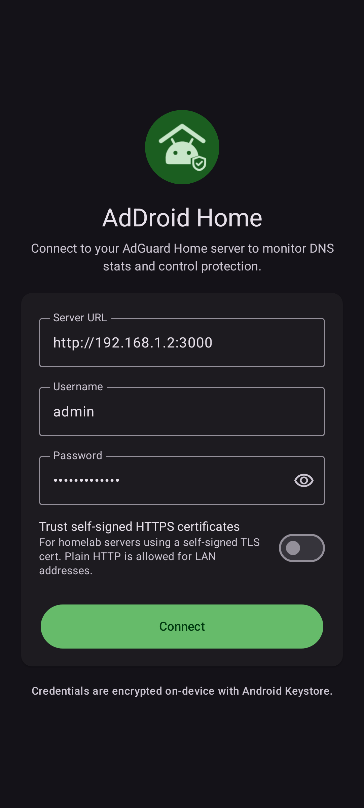
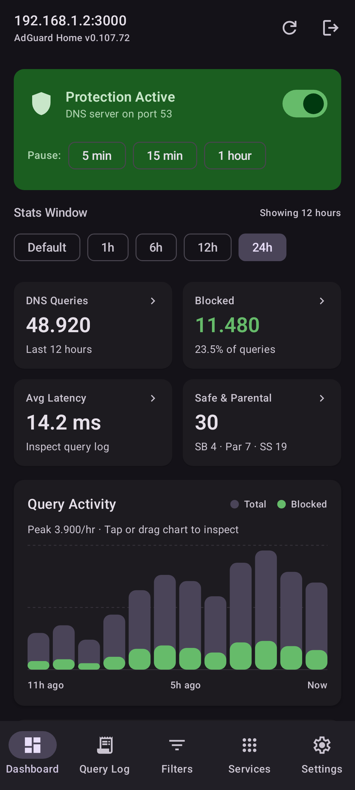

<p align="center">
  
</p>

<h1 align="center">AdDroid Home</h1>

<p align="center">
  Native Material 3 Android client for self-hosted AdGuard Home servers:<br>
  monitor live DNS analytics, inspect and filter the query log, and manage protection rules directly from your phone.
</p>

<p align="center">
  <a href="https://github.com/Syxhen/AdDroidHome/releases/latest"></a>
</p>

<p align="center">
  Android 12+ · Jetpack Compose &amp; Material 3 · AdGuard Home API · no root · <a href="#install">install the APK</a>
</p>

<p align="center">
  <a href="#requirements"></a>
  <a href="#requirements"></a>
  <a href="https://github.com/Syxhen/AdDroidHome/actions/workflows/ci.yml"></a>
  <a href="https://github.com/Syxhen/AdDroidHome/releases"></a>
  <a href="LICENSE"></a>
</p>

<p align="center">
  
  &nbsp;&nbsp;&nbsp;
  
</p>

## Overview

Managing an AdGuard Home instance from a mobile browser often means pinching,
zooming, and re-entering credentials on small screens. **AdDroid Home** talks
directly to your server's `/control/*` REST API with a native Jetpack Compose
and Material 3 interface, dynamic color support, and on-device encrypted
credential storage.

## Features

- **Interactive Dashboard & Charts**
  - One-tap master DNS protection toggle and quick pause presets (`5 min`,
    `15 min`, `1 hour`) with a live countdown timer.
  - Configurable **Stats Window** (`Default`, `1h`, `6h`, `12h`, `24h`, `7d`
    automatically capped to your server's statistics retention interval).
  - Clickable metric cards (**DNS Queries**, **Blocked**, **Avg Latency**,
    **Safe & Parental**) and clickable **Top Activity** lists (**Blocked**,
    **Queried**, **Clients**) that drill directly into the filtered Query Log.
  - Touch-interactive **Query Activity** chart (tap or drag to scrub buckets)
    and **Upstreams** share & latency breakdown.
- **Query Log**
  - Real-time search, version-aware status filters (supporting both modern
    `response_status` and legacy `reason` API schemas), cursor pagination,
    detailed inspection sheet, and one-tap **Block / Unblock** rule creation.
- **Filters & Custom Rules**
  - Global DNS filtering toggle, blocklist and allowlist management (toggle,
    add, remove, force upstream refresh), and a monospace custom rules editor.
- **Blocked Services**
  - Searchable catalog with category chips, `Blocked` filter toggle, staged
    multi-service edits, and schedule-preserving updates via
    `PUT /control/blocked_services/update`.
- **Settings & DNS Rewrites**
  - Toggle **Safe Browsing**, **Parental Control**, and **Safe Search**
    (master switch plus individual engine chips for Google, Bing, YouTube,
    DuckDuckGo, Ecosia, Pixabay, and Yandex).
  - Full **DNS Rewrites** CRUD (add, edit, enable/disable, delete), gracefully
    handling both legacy and schema-v31 AdGuard Home servers.
  - Confirmation-guarded **Clear Query Log** and **Reset Statistics** actions.
- **Security & Privacy**
  - Credentials are encrypted on-device with **AES-256-GCM** using a hardware-
    backed **Android Keystore** key.
  - Plain HTTP is strictly restricted to private/LAN targets (`RFC 1918`,
    link-local, loopback, `.local`) at the OkHttp layer; public hosts require
    HTTPS.
  - Opt-in trust for self-signed homelab TLS certificates and user-installed
    root CAs.
  - Zero telemetry, zero analytics, and zero third-party cloud relays — the app
    communicates solely with the AdGuard Home server you configure.

## Permissions

Every permission declared in `AndroidManifest.xml` is listed below along with
the exact reason it is required:

| Permission | Type | Why it is required |
|---|---|---|
| `android.permission.INTERNET` | Normal (install-time) | Required to connect directly to your AdGuard Home server's `/control/*` REST API over HTTPS or private-LAN HTTP. No external analytics, crash-reporting, or third-party endpoints are contacted. |
| `android.permission.ACCESS_NETWORK_STATE` | Normal (install-time) | Allows the app to inspect basic network connectivity state so unreachable server or offline states can be surfaced cleanly instead of failing silently. |
| `android.permission.ACCESS_LOCAL_NETWORK` | Runtime (Android 17 / API 37+) | Android 17 restricts sockets to private LAN addresses (`192.168.x.x`, `10.x.x.x`, `172.16–31.x.x`, `.local`) unless the user explicitly grants Local Network access. Requested at runtime on Android 17+ so the app can reach your local AdGuard Home server without timing out. |

No other permissions are requested (no location, camera, contacts, storage,
notifications, or persistent background services), and **no root access** is
required.

## Requirements

- Android 12 (API 31) or later (tested through Android 17 / API 37).
- A reachable **AdGuard Home** server (`v0.107.x` or newer) with admin
  credentials.
- Local Wi-Fi / LAN access, VPN (e.g., WireGuard / Tailscale), or an HTTPS
  reverse proxy in front of your AdGuard Home instance.

## Install

Each [release](https://github.com/Syxhen/AdDroidHome/releases/latest) includes
two APKs and a `SHA256SUMS.txt` checksum file:

- **`addroidhome.apk`** — standard release build for everyday use (minified and
  optimized with R8).
- **`addroidhome-debug.apk`** — side-by-side debug build
  (`AdDroid Home (Debug)`) for testing alongside the release build.

### Via ADB

```sh
adb install -r addroidhome.apk
```

### Direct sideload on the phone

1. Download `addroidhome.apk` from the
   [latest release](https://github.com/Syxhen/AdDroidHome/releases/latest).
2. Open the downloaded APK on your device and allow installation from your
   browser or file manager if prompted.

Pre-release builds (tags such as `v1.1.0-beta.1`) are published as GitHub
pre-releases and do not replace the `releases/latest` link.

## First-time setup

1. Open **AdDroid Home**.
2. Enter your AdGuard Home **Server URL**:
   - Local network HTTP (e.g., `http://192.168.1.2:3000` or `192.168.1.2:3000`)
   - HTTPS reverse proxy or TLS-enabled server (e.g., `https://adguard.home.local`)
3. Enter your AdGuard Home **Username** and **Password**.
4. If your server uses a self-signed TLS certificate, enable **Trust
   self-signed HTTPS certificates**.
5. Tap **Connect**. On **Android 17+**, grant the **Local Network** permission
   when prompted so the app can reach LAN IP addresses.

## Roadmap

- **Multi-server profiles** — save and switch between primary and secondary
  AdGuard Home instances (e.g., HA homelab setups).
- **Clients management** — inspect runtime & persistent clients via
  `/control/clients` with per-client filtering, Safe Search, and blocked
  services overrides.
- **Home screen widget & Quick Settings tile** — view live block stats and
  pause DNS protection directly from the launcher or notification shade.
- **DNS & DHCP controls** — view and edit upstream DNS servers, bootstrap
  resolvers, and DHCP leases.
- **In-app GitHub updater** — optional Stable/Beta release checker with
  SHA-256 verification and in-place APK installation.

## Build & Tests

Requires JDK 25 (or Gradle daemon toolchain auto-provisioning) and Android SDK
platform 37:

```sh
./gradlew :app:testDebugUnitTest :app:assembleDebug :app:assembleRelease
```

Built APKs are written to:
- `app/build/outputs/apk/debug/addroidhome-debug.apk`
- `app/build/outputs/apk/release/addroidhome-release.apk` (or `-unsigned.apk`
  when signing env vars are not set)

GitHub Actions runs unit tests and builds both debug and release APKs on every
push and pull request.

## License

Licensed under the **Apache License, Version 2.0**. See [LICENSE](LICENSE) and
[NOTICE](NOTICE) for details.

Per Sections 4 and 6 of the Apache License 2.0, forks and redistributions must
retain attribution to **AdDroid Home** (`Syxhen/AdDroidHome`) via the `NOTICE`
file and may not use the **AdDroid Home** name or app icon to republish
derivative apps without prior written permission.

